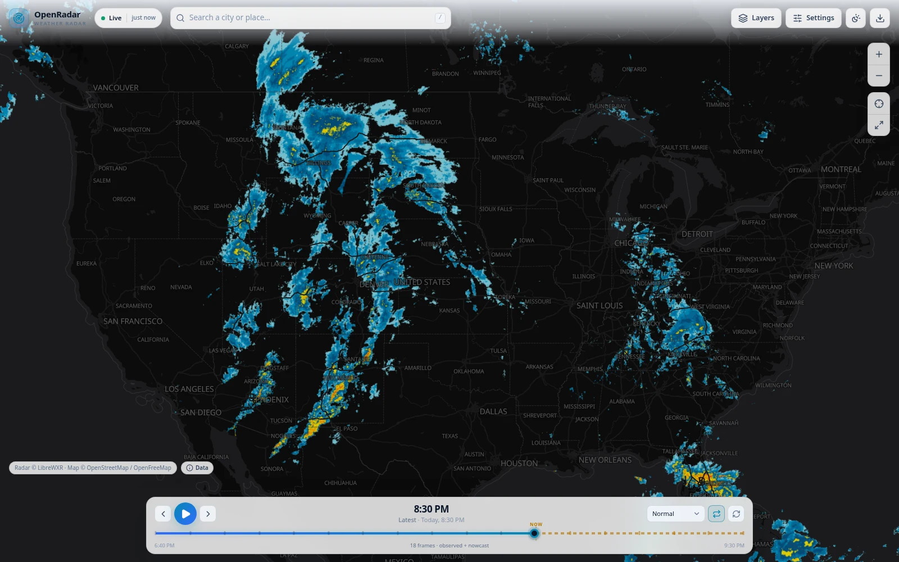
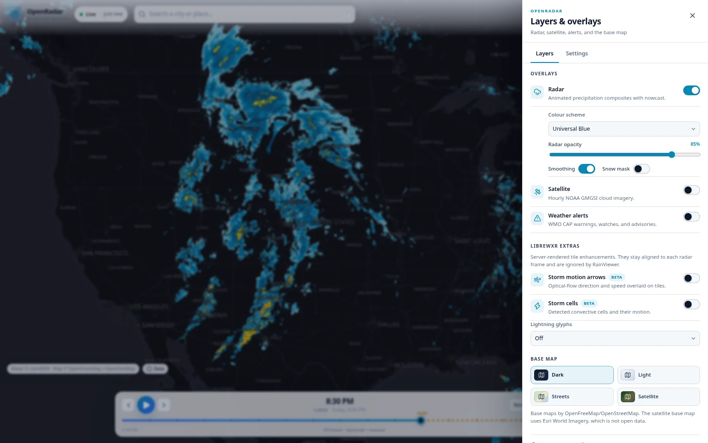
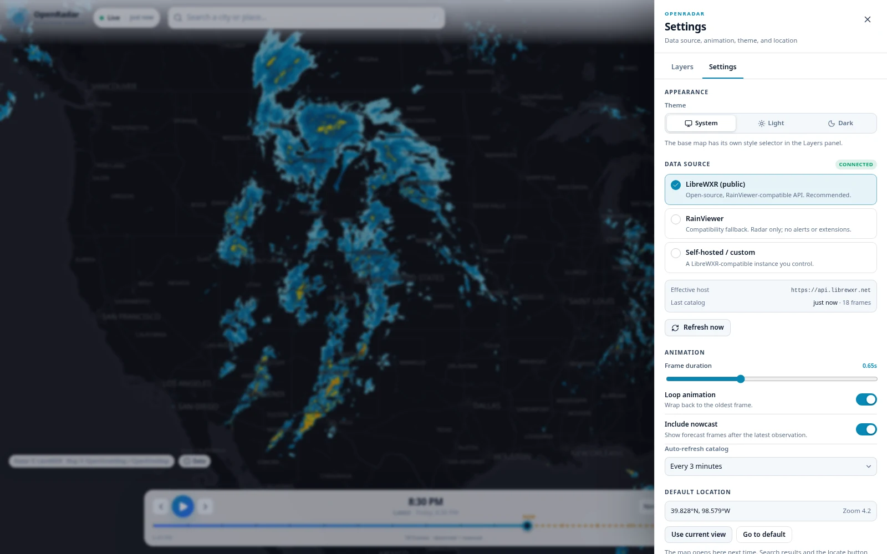
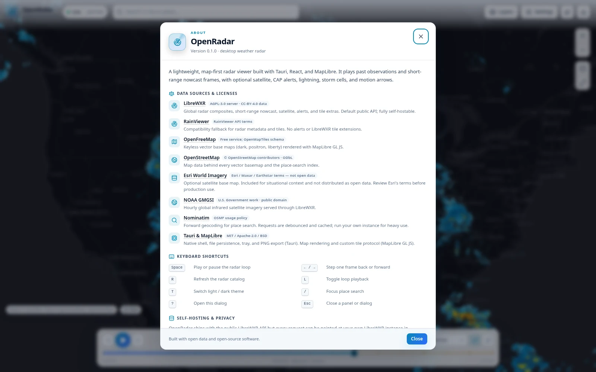

# OpenRadar

OpenRadar is a lightweight, map-first desktop weather radar viewer built with
**Tauri 2**, **React 19**, **TypeScript**, and **MapLibre GL JS**. It plays past
radar observations and short-range nowcast frames on a fast, north-up map, with
optional satellite imagery, weather alerts, lightning, storm cells, and motion
arrows.

The default data source is the public [LibreWXR](https://librewxr.net) API, a
free and open-source RainViewer-compatible service. No API key, account, or
cloud dependency is required. LibreWXR can also be self-hosted.

> OpenRadar is an independent project. It is not affiliated with MyRadar,
> Windy, RadarOmega, RainViewer, or Esri.

Full documentation — installation, user guide, configuration, architecture,
self-hosting, development, testing, and troubleshooting — starts at
[`docs/README.md`](docs/README.md).

---

## Screenshots

The default dark theme on the continental US view, with animated LibreWXR radar
and the observation/nowcast timeline:



| Layers & overlays | Settings |
| --- | --- |
|  |  |

The About dialog collects data-source licences and the keyboard shortcut list:



Screenshots are captured from the running app with live public data, so frame
counts, alert coverage, and timestamps will differ from what you see.

---

## Features

- **Animated radar** — observed frames plus optional nowcast, with play/pause,
  stepping, scrubbing, adjustable speed, and looping.
- **Timeline** — clearly marks the latest observation (`NOW`) and forecast
  frames; shows relative frame ages.
- **Palette from metadata** — every colour scheme advertised by the server
  (currently 15 plus raw grayscale) is available at runtime.
- **Radar options** — opacity, smoothing, snow mask.
- **Satellite overlay** — NOAA GMGSI infrared imagery, automatically matched to
  the radar frame's time.
- **Radar coverage overlay** — shows where LibreWXR has radar data.
- **Weather alerts** — WMO CAP alerts as a severity-coloured GeoJSON overlay,
  with clickable detail popups and viewport refresh.
- **LibreWXR tile extras** — storm motion arrows, storm cells, and lightning
  glyphs rendered server-side onto the radar tiles.
- **Base maps** — OpenFreeMap Dark, Positron, and Liberty, plus Esri World
  Imagery as an optional satellite base map.
- **Place search and geolocation** — Nominatim forward geocoding with debounce
  and caching, plus a browser/webview location button.
- **Auto-refresh** — polls the catalog every 3 minutes by default without
  interrupting playback.
- **Persistence** — settings are stored in a native JSON file under the app
  config directory (localStorage in the browser build).
- **PNG export** — saves the current map view with attribution baked in.
- **Desktop integration** — system tray with show/refresh/quit, native window,
  and fullscreen control.
- **Graceful failure** — keeps stale frames visible on refresh errors, falls
  back to an OSM raster style if a vector style fails, and reports tile or
  network problems as non-blocking toasts.
- **Keyboard shortcuts** and a responsive layout for narrow windows.

---

## Stack

| Layer | Choice |
| --- | --- |
| Desktop shell | Tauri 2 (Rust) |
| UI | React 19 + TypeScript 6 |
| Build | Vite 8 |
| State | Zustand 5 (persisted settings + ephemeral radar state) |
| Map | MapLibre GL JS 6 |
| Radar/satellite/alerts | LibreWXR (default), RainViewer fallback |
| Base maps | OpenFreeMap vector styles, Esri World Imagery |
| Geocoding | Nominatim |
| Icons | lucide-react |

There is no Electron, no bundled map renderer, and no required backend service.

---

## Quick start

### Prerequisites

- **Node.js 22 LTS** (Vite 8 requires a current Node 20.19+ or 22.12+; 22 LTS is
  recommended)
- **Rust stable** via [rustup](https://rustup.rs). Current Tauri 2 releases
  require Rust **1.90+**; run `rustup update stable` if needed.
- Platform webview and build dependencies listed below

### Install and run

```bash
npm install
npm run tauri:dev
```

`npm run tauri:dev` starts the Vite dev server on port `1420` and opens the
native window.

To work on the UI in a regular browser (no tray, native settings file, or native
PNG save):

```bash
npm run dev
# http://localhost:1420
```

### Build

```bash
npm run typecheck          # TypeScript only
npm run build              # frontend production bundle -> dist/
npm run tauri:build        # native installers/packages
```

`tauri:build` produces platform packages according to
`src-tauri/tauri.conf.json` (`"targets": "all"`): `.deb`, `.rpm`, and AppImage
on Linux; MSI/NSIS on Windows; `.app`/`.dmg` on macOS.

Rust-only check:

```bash
cargo check --manifest-path src-tauri/Cargo.toml
```

---

## Linux dependencies

Tauri 2 uses WebKitGTK 4.1. The tray feature also needs an AppIndicator
implementation.

### Fedora

```bash
sudo dnf install webkit2gtk4.1-devel openssl-devel curl wget file \
  libappindicator-gtk3-devel librsvg2-devel
sudo dnf group install "c-development"

# Optional: RPM bundling / AppImage tooling
sudo dnf install patchelf rpm-build
```

### Debian / Ubuntu

```bash
sudo apt update
sudo apt install libwebkit2gtk-4.1-dev build-essential curl wget file \
  libxdo-dev libssl-dev libayatana-appindicator3-dev librsvg2-dev

# Optional: AppImage tooling
sudo apt install patchelf
```

### Arch Linux

```bash
sudo pacman -S --needed webkit2gtk-4.1 base-devel curl wget file openssl \
  libappindicator-gtk3 librsvg patchelf
```

### Windows

- Install the **Microsoft C++ Build Tools** with the “Desktop development with
  C++” workload.
- Install Rust with the `stable-x86_64-pc-windows-msvc` toolchain.
- WebView2 is preinstalled on Windows 11 and current Windows 10; otherwise
  install the Evergreen WebView2 Runtime.
- Run the commands from a Developer PowerShell.

### macOS (untested)

- Xcode Command Line Tools (`xcode-select --install`) and Rust stable.

### Troubleshooting Linux rendering

Some NVIDIA + WebKitGTK combinations render a blank map. Try:

```bash
WEBKIT_DISABLE_DMABUF_RENDERER=1 npm run tauri:dev
```

For remote/SSH development, `TAURI_DEV_HOST` can expose the Vite server to a
device on the network; see `vite.config.ts`.

---

## Using OpenRadar

### Layers panel

- **Radar** — toggle, colour scheme, opacity, smoothing, snow mask.
- **Satellite** — NOAA GMGSI overlay and opacity.
- **Radar coverage** — toggle and opacity; shows where radar data exists
  (LibreWXR sources only).
- **Weather alerts** — CAP polygons; click a polygon for details.
- **LibreWXR extras** — motion arrows, storm cells, lightning glyphs. These are
  baked into radar tiles by the server and are only available on LibreWXR
  sources (not RainViewer).
- **Base map** — Dark, Light, Streets, Satellite.

### Settings panel

- Theme (system/light/dark) and data source selection.
- Frame duration, loop, nowcast inclusion, and catalog auto-refresh interval.
- Default map view (“Use current view”).
- Reset all settings and open the About/licences dialog.

The UI theme and the base map are independent: a light UI can still use the
Dark base map for radar contrast.

### Search and location

Type at least two characters in the search box. Results come from Nominatim and
are cached for the session. Selecting a result flies to its bounding box and
drops a marker. The crosshair button requests a one-shot high-accuracy
geolocation fix.

### Export

The download button captures the WebGL canvas and writes a PNG with the current
attribution footer. In the desktop app it is saved to
`Pictures/OpenRadar/openradar-<timestamp>.png` (falling back to Downloads or the
home directory). In the browser it downloads normally.

### Tray

The tray icon offers **Show OpenRadar**, **Refresh radar data**, and **Quit**.
The menu stays available while the window is open; closing the last window exits
the app. Use **Quit** to exit cleanly.

---

## Keyboard shortcuts

| Key | Action |
| --- | --- |
| `Space` | Play / pause the radar loop |
| `←` / `→` | Step one frame back / forward |
| `R` | Refresh the radar catalog immediately |
| `L` | Toggle loop playback |
| `T` | Toggle light / dark UI theme |
| `/` | Focus the place search box |
| `?` | Open the About / shortcuts dialog |
| `Esc` | Close the side panel or dialog |

Shortcuts are suppressed while typing in an input, textarea, select, or
content-editable element.

---

## Data sources and attribution

| Data | Default | Licence / terms | Self-hostable |
| --- | --- | --- | --- |
| Radar, nowcast, satellite, alerts | LibreWXR public API | Server code AGPL-3.0-or-later; API data CC-BY-4.0 | Yes |
| Radar fallback | RainViewer | RainViewer API terms | No |
| Vector base maps | OpenFreeMap | Free service; OpenMapTiles schema; data © OpenStreetMap (ODbL) | Yes (OpenFreeMap tooling) |
| Satellite base map | Esri World Imagery | **Not open data** — Esri/Maxar/Earthstar terms | No |
| Place search | Nominatim | OSM data (ODbL); Nominatim usage policy | Yes |
| Satellite imagery | NOAA GMGSI via LibreWXR | U.S. government work, public domain | Yes (via LibreWXR) |

OpenRadar shows attribution in the lower-left **Data** popover and repeats it in
the About dialog and exported images. See
[`docs/DATA_SOURCES.md`](docs/DATA_SOURCES.md) for endpoint details, licence
text, and operational caveats.

**Do not use OpenRadar for life-safety decisions.** Radar and alert data can lag
observations or be incomplete.

---

## Self-hosting LibreWXR

OpenRadar can point at any LibreWXR-compatible instance.

1. Deploy LibreWXR following the instructions in the upstream repository
   ([JoshuaKimsey/LibreWXR](https://github.com/JoshuaKimsey/LibreWXR)). The
   default listen address is usually `http://localhost:8080`.
2. Verify the catalog endpoint:

   ```bash
   curl http://localhost:8080/public/weather-maps.json
   ```

   It must return `radar.past` frames and a `host` field.
3. In OpenRadar, open **Settings → Data source → Self-hosted / custom**, enter
   the instance URL (for example `http://localhost:8080`), and click
   **Apply & reconnect**.
4. Make sure the instance serves `/v2/radar/...`, and optionally
   `/v2/satellite/...` and `/v2/alerts`. Radar tiles are available up to zoom
   12; satellite tiles up to zoom 6.
5. Enable the server-side features you expect to use (alerts, satellite,
   lightning/storm-cell extensions). If a feature is disabled, OpenRadar falls
   back to radar-only behaviour.

### CORS

LibreWXR allows all origins by default (`LIBREWXR_CORS_ORIGINS=["*"]`). If you
restrict it, allow the desktop app's webview origins:

- `tauri://localhost` on Linux and macOS
- `http://tauri.localhost` on Windows
- `http://localhost:1420` when running the browser dev build

The WebSocket handshake is subject to the same origin list.

### HTTPS and local networks

The app accepts `http://` and `https://` sources. Private-network addresses and
`localhost` default to `http://` when you omit the scheme; public hostnames
default to `https://`. Use a trusted TLS certificate for remote instances —
self-signed certificates are rejected by the webview.

### Public instance etiquette

The public `https://api.librewxr.net` instance is provided for testing and
small-scale use. It has no SLA. If you build on OpenRadar, self-host or run your
own proxy/cache and respect the upstream project's guidance.

---

## How the radar frame system works

A short version; the full explanation is in
[`docs/ARCHITECTURE.md`](docs/ARCHITECTURE.md).

1. On launch, OpenRadar fetches `/public/weather-maps.json` from the selected
   source.
2. Observed frames (`radar.past`) and forecast frames (`radar.nowcast`) are
   normalised, deduplicated by Unix timestamp, tagged `past` or `nowcast`, and
   sorted oldest-first. Satellite frames are normalised separately.
3. The timeline is a filtered view of that list. Including nowcast adds the
   forecast frames after the latest observation; excluding it leaves only
   observations.
4. **The frame timestamp is the identity.** The current frame is stored as
   `frameTime` rather than an array index, so a catalog refresh can add or drop
   frames without invalidating the user's position. If the timestamp disappears,
   the app selects the nearest remaining frame.
5. Playback is a `setTimeout` loop that advances `frameTime`; scrubbing writes
   the same field. The WebGL layer follows the timestamp, so playback and manual
   scrubbing share one code path.
6. Each frame has a distinct tile URL. A custom `openradar://` protocol handler
   resolves those URLs to HTTP, caches PNG bytes in a 64 MB LRU cache, and
   preloads the current frame plus two frames on either side to reduce flicker.
7. Satellite frames are hourly; OpenRadar picks the satellite frame nearest to
   the active radar time so the two overlays stay in sync.

Colour scheme, smoothing, snow mask, arrows, cells, and lightning are encoded in
the tile URL. Changing one of them naturally produces a new cache key and a new
raster source, without special-case invalidation logic.

---

## Project layout

```text
src/
  components/        UI: top bar, panels, timeline, dialogs, toasts
  config/            constants, data-source presets, base maps
  hooks/             metadata, timeline, animation, theme, alerts, preload
  map/               MapLibre lifecycle, layer sync, alert popups, map context
  services/          catalog, tiles/protocol/cache, alerts, geocoding, export
  store/             Zustand stores (settings, radar, alerts, UI)
  styles/            design tokens, layout, components, map CSS
  types/             settings and weather-domain types
  utils/             time, geo/tile math, fetch, errors, attribution
src-tauri/
  src/lib.rs         settings file, PNG export, tray menu, refresh event
  tauri.conf.json    window, CSP, bundle metadata
docs/
  ARCHITECTURE.md    frame system, state, map lifecycle, extension points
  DATA_SOURCES.md    endpoints, licences, attribution, self-hosting details
```

### Settings storage

| Platform | Path |
| --- | --- |
| Linux | `~/.config/com.mumma.openradar/settings.json` |
| Windows | `%APPDATA%\com.mumma.openradar\settings.json` |
| macOS | `~/Library/Application Support/com.mumma.openradar/settings.json` |

In the browser build, settings use `localStorage` under
`openradar-settings`. Writes are debounced (~250 ms) and native writes are
atomic with `0600` permissions on Unix.

---

## Limitations and roadmap

- The public LibreWXR instance is best-effort; self-host for reliability.
- Radar source tiles stop at zoom 12 (overzoomed beyond that); satellite stops
  at zoom 6.
- RainViewer mode is radar-only: no alerts, satellite, or LibreWXR tile extras.
- Weather alerts depend on upstream CAP coverage and may lag or be incomplete.
- Esri World Imagery is included for convenience but is **not open data**.
- Live push is not implemented yet. The app polls every 3 minutes. The planned
  extension is a WebSocket client for LibreWXR's `/v2/ws` topics
  (`weather-maps`, `alerts`, `lightning`, `storm-cells`); see the extension
  notes in `docs/ARCHITECTURE.md`.
- The browser build is PWA-friendly by design but does not ship a service worker
  or manifest yet.
- Tauri mobile targets are not configured or tested.

See [`docs/ROADMAP.md`](docs/ROADMAP.md) for planned work and explicit
non-goals.

---

## Documentation

Start at the documentation hub: [`docs/README.md`](docs/README.md). It has
role-based reading paths for users, operators, and contributors.

**Using OpenRadar**

- [`docs/GETTING_STARTED.md`](docs/GETTING_STARTED.md) — prerequisites, install,
  first launch, first build.
- [`docs/USER_GUIDE.md`](docs/USER_GUIDE.md) — every control, panel, and state.
- [`docs/CONFIGURATION.md`](docs/CONFIGURATION.md) — defaults, ranges, settings
  paths, data sources, caching constants.
- [`docs/TROUBLESHOOTING.md`](docs/TROUBLESHOOTING.md) and
  [`docs/FAQ.md`](docs/FAQ.md) — common problems and short answers.

**Operating and self-hosting**

- [`docs/DATA_SOURCES.md`](docs/DATA_SOURCES.md) — endpoints, licences,
  attribution, privacy, and operational caveats.
- [`docs/SELF_HOSTING.md`](docs/SELF_HOSTING.md) — deploying LibreWXR, CORS,
  TLS, capacity, and verification.
- [`docs/SECURITY_PRIVACY.md`](docs/SECURITY_PRIVACY.md) — trust boundaries,
  CSP, local data, and threat model.

**Developing and releasing**

- [`docs/ARCHITECTURE.md`](docs/ARCHITECTURE.md) — frame system, tile pipeline,
  stores/hooks, map lifecycle, extension points.
- [`docs/CODE_REFERENCE.md`](docs/CODE_REFERENCE.md) — module-by-module exports
  and signatures.
- [`docs/DEVELOPMENT.md`](docs/DEVELOPMENT.md) — setup, scripts, conventions,
  debugging.
- [`docs/BUILDING.md`](docs/BUILDING.md) — release builds, bundles, versioning,
  release checklist.
- [`docs/TESTING.md`](docs/TESTING.md) — checks and the manual regression
  matrix.
- [`docs/CONTRIBUTING.md`](docs/CONTRIBUTING.md),
  [`docs/ROADMAP.md`](docs/ROADMAP.md), and
  [`docs/CHANGELOG.md`](docs/CHANGELOG.md).

The in-app **About** dialog repeats the data-source licences and keyboard
shortcuts.

---

## Licence

The OpenRadar source code is released under the [MIT Licence](LICENSE).

The MIT licence applies **only to the source code in this repository**. It does
not grant rights to weather data, radar or satellite tiles, base maps, imagery,
or geocoding results. Those remain under their respective licences and terms;
see [`docs/DATA_SOURCES.md`](docs/DATA_SOURCES.md). In particular, Esri World
Imagery is **not** open data.

The LibreWXR server is AGPL-3.0-or-later, but OpenRadar only consumes its public
HTTP API and does not include or link against LibreWXR code. If you copy or
modify LibreWXR itself, its licence applies to that separate work.
